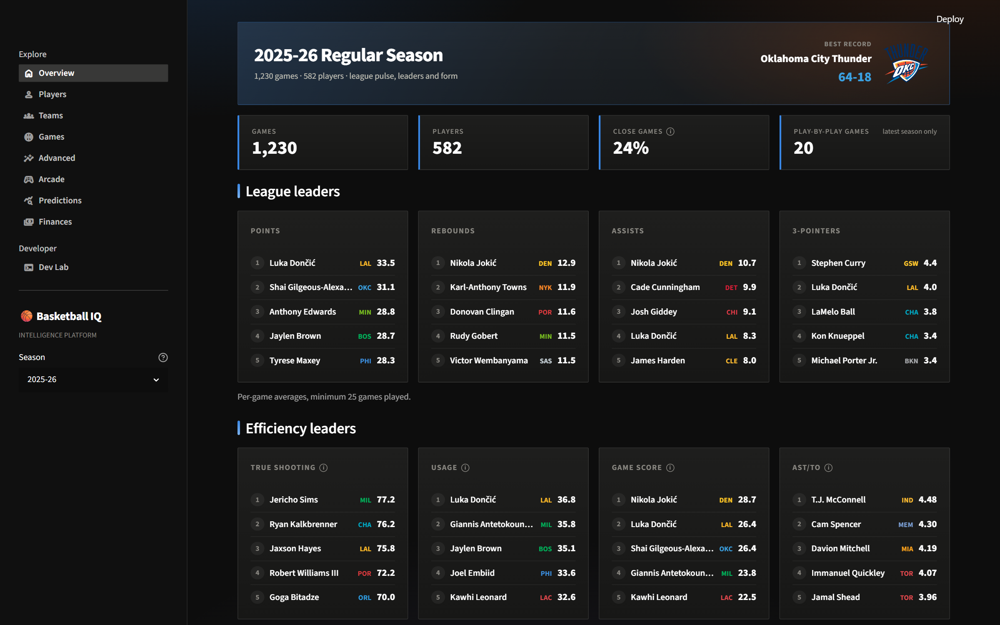
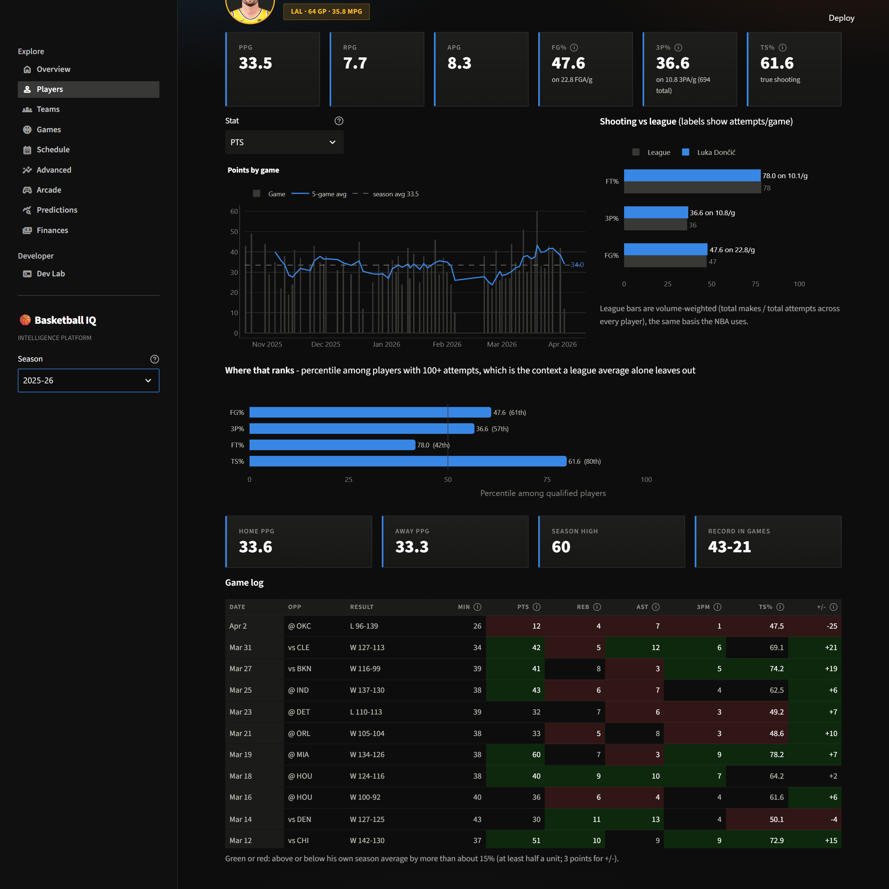
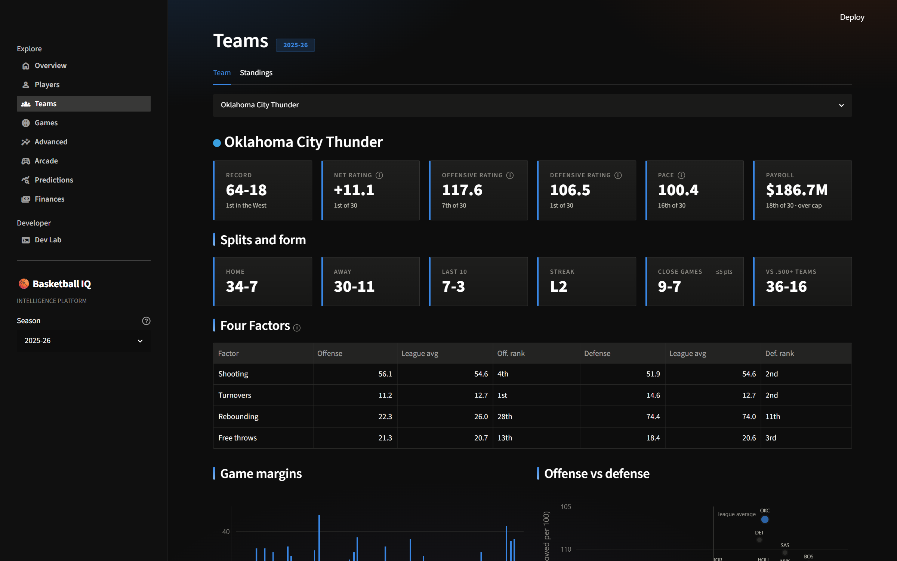
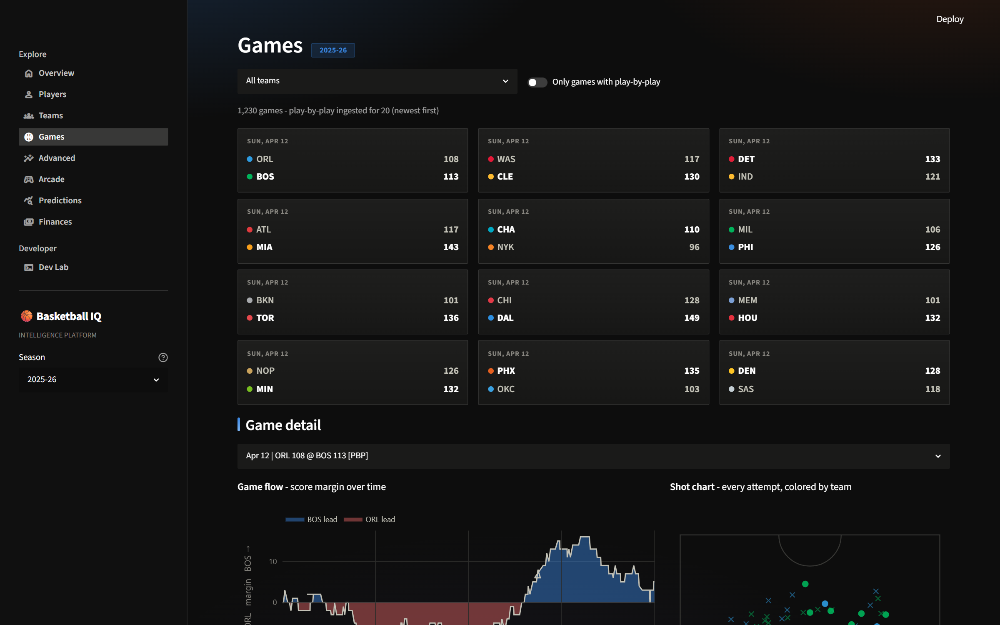
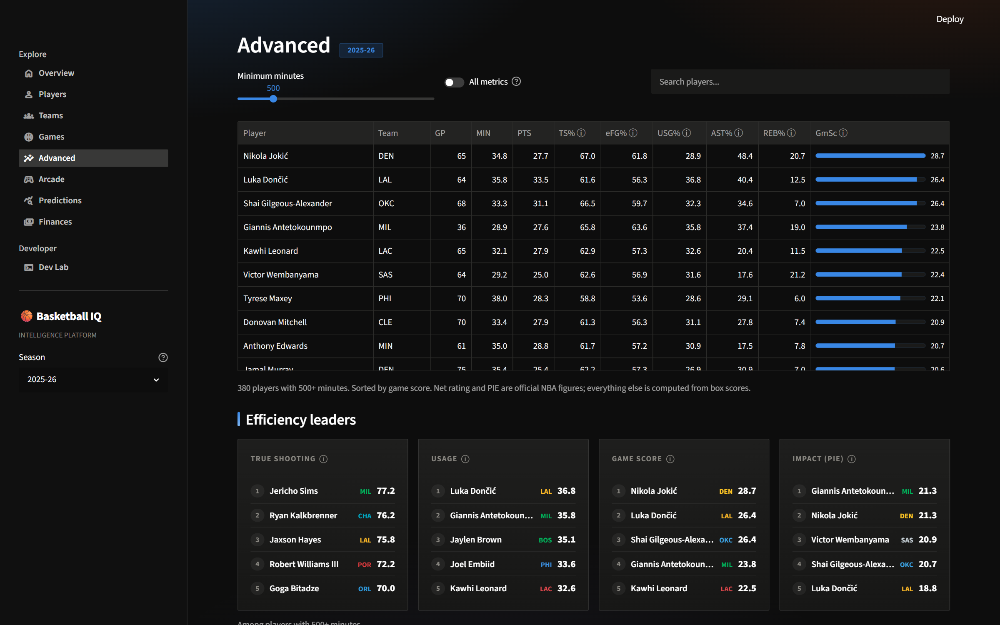
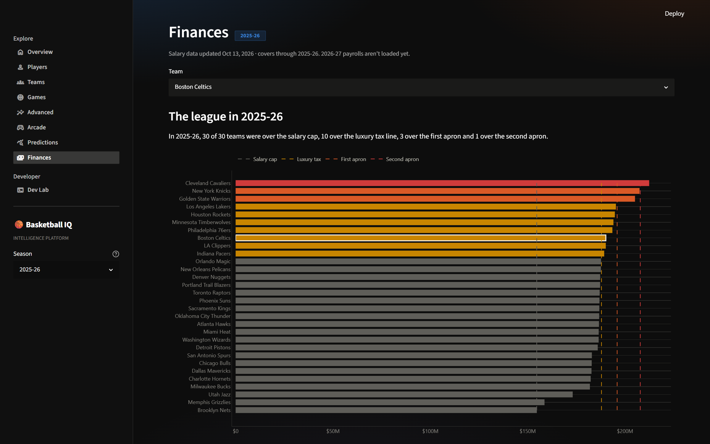
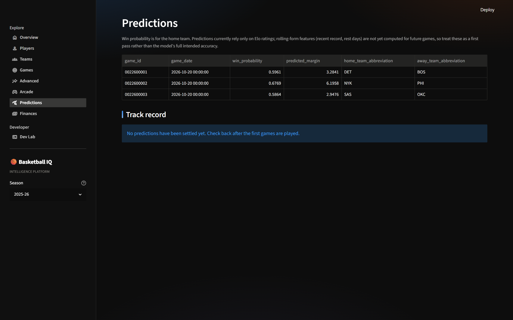
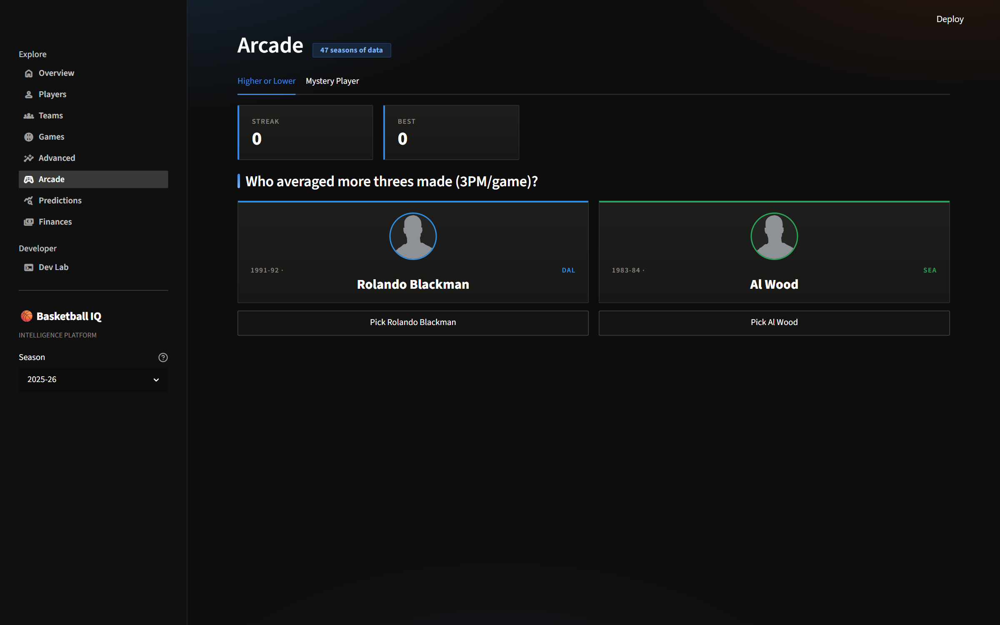

# Basketball Intelligence Platform 🏀

**Live dashboard:** https://basketball-intelligence-platform.streamlit.app

A local-first NBA data platform: ingest NBA stats and team salaries, warehouse
them in DuckDB, model them with dbt, and serve a public dashboard covering
players, teams, games, advanced stats, team finances and game predictions
across 47 seasons of NBA history. Natural-language Q&A is not built yet; see
Status / roadmap below.

## Screenshots

**Overview** - best record, league and efficiency leaders, conference standings


**Players** - season stats table; player detail with scoring trend and
shooting-vs-league comparison


**Teams** - one team in depth: ratings with league ranks, the Four Factors,
record splits and its roster, with full standings in their own tab


**Games** - results browser; game detail with a score-margin flow chart and
shot chart


**Advanced** - rate metrics with hover explanations, efficiency leaderboards
and a per-player percentile profile


**Finances** - every team's payroll against the cap, tax and apron lines,
with a plain-English summary and the team's biggest contracts


**Predictions** - upcoming games as cards with each team's win probability
and the expected margin, plus the model's track record


**Arcade** - Higher or Lower, Mystery Player, and Build a team: build or
draft an 8-man rotation from one season or all-time, then simulate how it
would do


## Architecture

```
stats.nba.com (via nba_api)        Basketball-Reference (team salary pages)
        |  rate-limited ingestion          |  throttled scrape
        v                                  v
data/raw/*.parquet                 raw extracts, one file per season, each
                                   written whole or not at all
        |  scripts/load_to_duckdb.py
        v
warehouse/next/basketball.duckdb   a copy of the DuckDB warehouse (raw schema)
                                   that the refresh builds into
        |
        v
dbt (dbt-duckdb)
        - seeds         salary cap / tax / apron history, team codes
                        (both hand-curated)
        - staging       clean, rename, type raw tables (views)
        - intermediate  pair each team-game with its opponent
        - marts         every number the site shows: player seasons, stints
                        and careers, team seasons, standings, game features,
                        team finances, contracts, graded predictions
        |
        v
ml/                                Elo + ridge model; appends predictions to
                                   data/predictions/history.csv (committed);
                                   scores every player-season for the Arcade
        |  every required step passed: the copy is swapped onto
        |  warehouse/basketball.duckdb
        v
GitHub Release (data-v1)           the published warehouse file, then version.txt
        |  downloaded on boot, re-checked hourly
        v
dashboard/ (Streamlit + Plotly)    the public app; reads the marts through
                                   dashboard/lib/data/
```

Every Python stage imports `core/`, a small shared package: where the data
lives, crash-safe file writes, the constants and team-code facts the
pipeline and the pages share, and search-text folding. Each rule is defined
once, there or in a dbt mart.

`scripts/weekly_refresh.py` runs that whole chain once a week from a local
Windows Scheduled Task (see "How the data refresh works" below). A diagram of the full system, including CI and
hosting, is in [docs/architecture.excalidraw](docs/architecture.excalidraw)
(open it at excalidraw.com), and the reasoning behind the main choices is in
[docs/adr/](docs/adr/).

## Data sources

Game data comes from the **unofficial stats.nba.com API** via the
[`nba_api`](https://github.com/swar/nba_api) Python package:

| Dataset | Endpoint | Grain | API calls |
|---|---|---|---|
| Player box scores | `LeagueGameLog` (player mode) | player × game | 1 per season |
| Team box scores | `LeagueGameLog` (team mode) | team × game | 1 per season |
| Play-by-play | `PlayByPlayV3` | event | **1 per game** |
| Player advanced stats | `LeagueDashPlayerStats` (Advanced) | player × season | 1 per season |
| Team advanced stats | `LeagueDashTeamStats` (Advanced) | team × season | 1 per season |
| Schedule | `ScheduleLeagueV2` | game, including unplayed | 1 per season |
| Player index | `CommonAllPlayers` | player (all-time) | 1 |
| Teams | `nba_api` static data | franchise | 0 |

Net rating and PIE are the NBA's own official advanced stats, available from
1996-97 onward. Earlier seasons derive the equivalent rate stats from box
scores instead - see `stg_player_advanced.sql` and `mart_player_season.sql`
for the exact cutoffs.

Because the API is unofficial and throttles aggressive clients, every request
goes through a rate limiter (≥1.5s between calls) with exponential-backoff
retries. Play-by-play is the expensive dataset (~1,300 calls for a full
season), so each run adds only games the season's file doesn't hold yet, newest
first, at most 120 by default (the same cap the weekly refresh uses). Change it
with `--pbp-games N` or pull everything missing with `--all-pbp`.

Salary data is not available from nba_api, so it is scraped separately from
**Basketball-Reference** (`ingestion/team_payroll_ingest.py`, one request per
3.5 seconds), back to 1984-85:

| Dataset | Grain | Rows |
|---|---|---|
| Team payroll | team × season | 1,200 |
| Player salaries | salary line (player × team × season) | ~19,300 |

League salary cap, luxury tax and apron levels are a hand-curated dbt seed
(`seeds/salary_cap_history.csv`), since they are league announcements rather
than something derivable from a source table.

Payroll here is the sum of the salaries Basketball-Reference lists for a
team's season, which approximates the league's official tax bill rather than
reproducing it: the real bill prorates mid-season trades and counts money
owed to waived players. Checked against the one season with a clean official
comparison, 2023-24: all eight teams that actually paid tax are over the line
here, and so are four more that finished within $2.5M of it
(`dbt/basketball_intelligence/tests/assert_team_finances_flags_2023_24_taxpayers.sql`).

## Project layout

```
core/                              # shared by every stage: paths, atomic writes and
                                   # retries, constants, team codes, text, formats
ingestion/nba_ingest.py            # NBA game data into data/raw/*.parquet
ingestion/team_payroll_ingest.py   # Basketball-Reference salaries into data/raw/
scripts/load_to_duckdb.py          # data/raw into the warehouse (raw schema)
scripts/weekly_refresh.py          # the whole pipeline in a copy, then swap and publish
scripts/backfill_team_payroll.py   # one-time salary history backfill
scripts/health_check.py            # is the data fresh and the API still reachable
dbt/basketball_intelligence/       # dbt project (seeds / staging / intermediate / marts)
ml/                                # Elo ratings, ridge model, backtest, predictions,
                                   # player impact model (player_impact.py)
dashboard/app.py                   # Streamlit app entry point
dashboard/lib/data/                # read-only queries, one module per domain
dashboard/lib/                     # charts, cards, theme, simulator, franchise lineage,
                                   # payroll wording, stat glossary
dashboard/views/                   # one module per page; arcade/ is a package with
                                   # one module per game
data/predictions/history.csv       # every published prediction (committed)
data/fixtures/                     # small real-data slices CI builds its warehouse from
tests/                             # pytest suite
docs/adr/                          # architecture decision records
logs/refresh_runs.jsonl            # one line per refresh run (committed)
warehouse/, data/raw/              # generated locally (gitignored); BIP_DATA_HOME
                                   # moves them out of the repo
```

## Dashboard

`streamlit run dashboard/app.py` gives you a dark, FotMob-inspired stats app.
Stats a casual fan may not know carry a small ⓘ that explains them on hover,
all drawn from one glossary (`dashboard/lib/glossary.py`).

- **Overview**: the team with the best record, league leaders, efficiency
  leaders (true shooting, usage, game score, assist-to-turnover), conference
  standings, latest games
- **Players**: filterable season stats table; player detail with scoring
  trend (5-game rolling average) and shooting-vs-league comparison; a career
  view pooling every season
- **Teams**: a Team tab with record and seed, net/offensive/defensive rating
  and pace with league ranks, the team's payroll, the Four Factors (shooting,
  turnovers, rebounding, free throws - offense and defense, against the
  league average), home/away, last-10, streak, close-game and vs-winning-team
  records, a per-game margin chart and its roster; a Standings tab with
  last-5 form for either conference or the whole league. A player traded
  mid-season counts on each roster only for the games he played there, and
  the Players and Advanced tables label him with both teams (CHI → BOS)
- **Games**: results browser; game detail with box scores and, for games
  with play-by-play ingested, a game-flow (score margin) chart and shot chart
- **Advanced**: rate metrics (true shooting, usage, assist/rebound/steal/block
  rates, game score) with a minutes floor, efficiency leaderboards, a
  percentile profile per player, and a two-player head-to-head. Official NBA
  figures are used where the league publishes them (1996-97 on) and box-score
  derivations fill in earlier seasons
- **Finances**: every team's payroll for a season against that year's salary
  cap, luxury tax and (2023-24 on) apron lines, with an explainer of what the
  lines mean. Each team gets a plain-English summary, its biggest contracts,
  and its payroll history. Relocated teams are one franchise, following the
  contracts: Seattle's 1984-2008 payroll sits with Oklahoma City, and the
  original Charlotte Hornets' with New Orleans. Seasons where the source's
  salary data is incomplete show as gaps rather than misleadingly low totals,
  and the page says when the salary data was last updated
- **Predictions**: upcoming games grouped by date, each a card with the
  tip-off time (Eastern), a two-team win-probability bar and a verdict like
  "BOS by 6 · 65%". Once games settle: accuracy, Brier score, margin error, a
  calibration chart (how often a 70% favorite actually won) and recent
  results with ✓/✗. Currently Elo ratings only - rolling-form features
  (recent record, rest days) aren't computed for future games yet, so treat
  it as a first pass rather than the model's intended accuracy
- **Arcade**: games on top of the full history. *Higher or Lower* (which
  player-season averaged more, streak scoring), *Mystery Player* (identify a
  notable season from progressively revealed clues) and *Build a team*:
  pick an 8-man rotation from one season or all-time under a credit budget
  and choose who starts, or draft one spot at a time by picking one of three
  offered players (a hidden 34-40 credit budget decides who is offered), then
  see a projected record (1,000 simulated seasons, stable for the same
  roster) and play out single seasons game by game. Players are rated by
  `ml/player_impact.py`, a ridge model fit on individual on-court plus-minus
  using box-score rates relative to each season's league average, so players
  from different eras compare fairly
- **Dev Lab** (owner-only): SQL workbench with schema browser, read-only
  queries, CSV/JSON/Parquet export, and a quick chart builder.
  Unlocked by `DEV_PASSWORD` in `.env` (copy `.env.example`); hide it
  entirely on public deploys with `DEV_LAB_ENABLED=false`.

To put the app on the public internet for free, see [DEPLOYMENT.md](DEPLOYMENT.md).

## Setup

Requires Python 3.12, the version CI, the Docker image and the Streamlit
Cloud app run. The lock files pin exact package versions for it.

```powershell
py -3.12 -m venv .venv
.\.venv\Scripts\Activate.ps1
python -m pip install --upgrade pip
pip install -r requirements.txt -r requirements-dev.txt
pre-commit install

# Optional: the Dev Lab password, and BIP_DATA_HOME to keep the data
# outside the repo (see CONTRIBUTING.md)
copy .env.example .env
```

[CONTRIBUTING.md](CONTRIBUTING.md) covers the lock files, the data location
variables, the test and lint commands, and the rules for changing the
warehouse.

## Running the pipeline

```powershell
# 1. Verify API connectivity (one small request, writes nothing)
python ingestion\nba_ingest.py --smoke-test

# 2. Ingest a season (defaults to the current season, up to 120 new games of play-by-play)
python ingestion\nba_ingest.py --season 2025-26 --pbp-games 120

# 2b. Or backfill history (resumable; skips seasons already on disk).
#     1979-80 is the start of the 3-point era; earlier seasons lack most stats.
python ingestion\nba_ingest.py --backfill 1979-80 --pbp-games 0

# 3. Load raw parquet into DuckDB
python scripts\load_to_duckdb.py

# 3b. Backfill team salaries, 1984-85 on (about 70 minutes at the source's
#     rate limit; needs step 3 first, since it reads the team list from the
#     warehouse), then load again to pick the new files up
python scripts\backfill_team_payroll.py
python scripts\load_to_duckdb.py

# 4. Build and test the dbt models: seeds first (the salary cap and team
#    code tables are hand-curated, not derived from a raw source), then
#    each model followed by its tests. dbt does not read .env, so if you
#    set BIP_DATA_HOME there, point dbt at the same warehouse first
$env:BIP_WAREHOUSE = python -c "from core import paths; print(paths.warehouse_path())"
cd dbt\basketball_intelligence
dbt build --profiles-dir .
cd ..\..

# 5. Score every player-season for the Arcade team builder, then predict
#    the upcoming games and score any that have finished
python -m ml.player_impact
python -m ml.predict
python -m ml.evaluate

# 6. Run the test suite (CONTRIBUTING.md has the CI-style run)
python -m pytest -q

# 7. Explore locally in the dashboard (same app as the live deploy)
streamlit run dashboard\app.py
```

Staging models land as views in the `main_staging` schema of
`warehouse/basketball.duckdb`, e.g.:

```sql
select player_name, round(avg(points), 1) as ppg
from main_staging.stg_player_game_logs
group by 1 order by ppg desc limit 10;
```

## How the data refresh works

`python scripts\weekly_refresh.py` runs steps 2 to 5 for the current season,
then publishes. A Windows Scheduled Task runs it every Tuesday.

- **It builds in a copy.** The run copies the warehouse to
  `warehouse/next/basketball.duckdb` and every step writes there. Only when
  every required step passes is the copy swapped onto the real file and
  uploaded. A failed run deletes the copy, so the site keeps last week's
  data instead of half of this week's.
- **Two steps are optional.** The salary scrape and the Arcade's player
  ratings can fail without stopping the run; the warehouse keeps last
  week's tables for them.
- **Play-by-play accumulates.** Each run adds up to 120 games the season's
  file doesn't hold yet, so older games keep their game-flow and shot
  charts.
- **Predictions are kept in git.** New predictions are appended to
  `data/predictions/history.csv`, which is committed with the run log. A run
  that doesn't publish puts the file back as it found it.
- **`--no-publish` is a dry run.** Every step runs against the copy, then
  the copy is deleted: nothing is swapped, uploaded or committed.
- **Every run leaves a record.** `logs/refresh_runs.jsonl` gets one line
  per run (committed), and `logs/runs/<run time>/` holds each step's full
  output.

[DEPLOYMENT.md](DEPLOYMENT.md) covers the scheduled task and publishing, and
[ADR 0009](docs/adr/0009-atomic-writes-and-building-the-warehouse-in-a-copy.md)
explains why it works this way.

## Status / roadmap

- [x] Ingestion with rate limiting; 47 seasons backfilled (1979-80 to 2025-26,
      ~1.09M player-game rows, ~106K team-game rows) plus play-by-play for
      recent games. Game logs land as one parquet per season under
      `data/raw/player_game_logs/` etc., so backfills resume where they left off
- [x] DuckDB warehouse with `raw` schema
- [x] dbt staging (10 models), intermediate (1) and marts (11), plus salary
      cap history and team code seeds; 113 dbt tests and 635 pytest cases.
      CI runs ruff, mypy, `dbt build` and pytest against small committed
      fixtures cut from the real data (`data/fixtures/`), which cover every
      era the tests check; the 6 tests that need all seasons are marked
      `full_warehouse` and run locally only
- [x] Advanced metrics: per-possession ratings, usage and rate stats, four
      factors. Official NBA advanced stats pulled for 1996-97 onward (one API
      call per season); earlier seasons derived from box scores, and withheld
      entirely before 1985-86 where the source has no rebound or turnover data
- [x] Team payroll and per-player salaries vs salary cap, luxury tax and apron
      lines (Basketball-Reference, 1984-85 on; Finances page)
- [x] Game predictions: Elo ratings feeding a ridge model, evaluated with a
      walk-forward backtest (`ml/`; Predictions page). The public track record
      starts with the 2026-27 season, so it has no settled games yet
- [x] Arcade team builder: a player impact model (ridge on on-court
      plus-minus, era-relative box-score rates) and a numpy season and playoff
      simulator
- [x] Weekly scheduled refresh (`scripts/weekly_refresh.py`, local Windows
      Scheduled Task), built in a copy and swapped in only when it passes. It
      re-fetches the current season's game logs in full (one call each) and
      adds only the play-by-play it doesn't hold yet
- [ ] Play-by-play for older games: it accumulates from October 2026 on,
      and earlier games aren't backfilled (`--all-pbp` can, slowly)
- [ ] Alerting when a scheduled refresh fails or stops running
- [ ] Lineup and on/off data (needs possession-level substitution parsing)
- [ ] Full Q&A dashboard (natural-language questions over marts)
